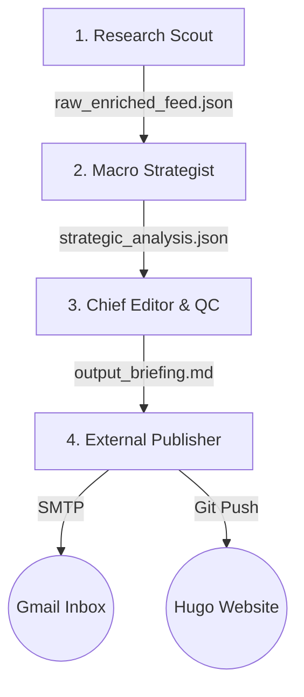

# Digital Asset Intelligence Engine (Project ID: DA-INTEL-01)

An automated, multi-agent pipeline designed to discover, enrich, filter, and synthesise weekly regulated wholesale institutional digital asset developments into a publication-ready brief. 

Outputs are delivered directly as a styled HTML newsletter to my Gmail and auto-deployed as a markdown post to my Hugo-based website.

---

## Multi-Agent Execution Graph

The engine runs as a sequence of three virtual agents, followed by an automated publishing coordinator:



1. **The Research Scout (`scout`)**
   - **Trigger**: Instantiated via scheduler or manually.
   - **Action**: Invokes `pipeline/ingestion.py` to scrape high-signal RSS feeds (CoinDesk, The Block, the Bank for International Settlements, Ledger Insights, the European Central Bank, and the Bank of England).
   - **Sources** (configured in `pipeline/feeds.py`), chosen for relevance rather than brand:
     - **Targeted Google News searches** (UK edition, last 7 days) for each core theme: tokenised deposits, wholesale settlement networks (Fnality, Kinexys, Canton, Partior, Agorá), the UK Digital Securities Sandbox and BoE, wholesale CBDCs, stablecoin regulation, tokenised funds and RWAs, FMIs (Euroclear, DTCC, Swift and others), and UK banks. These cover the whole week however busy the news is.
     - **Specialist press** read through site-restricted searches: Ledger Insights (its own feed serves only one item) and Finextra (which blocks automated clients).
     - **Primary sources**: Bank of England, FCA, HM Treasury, ECB, BIS (central bank speeches, FSI), Federal Reserve, FSB, ESMA, EBA, IOSCO and HKMA, filtered to digital-asset and market-infrastructure topics.
     - **General press**, narrowed by keyword filters: CoinDesk and The Block (institutional stories only), and Banking Dive, Payments Dive and Global Custodian (digital-asset stories only).
   - **Filtering & limits**: word-boundary keyword filters per source type; items older than 8 days are skipped (`INGEST_LOOKBACK_DAYS`); duplicates across feeds are removed by URL and headline; each feed is capped at 15 items (`INGEST_MAX_ITEMS_PER_FEED`). Per-feed counts are logged on every run.
   - **Feed health**: `pipeline/feed_check.py` (workflow `feed_health.yml`) probes every source when the feed configuration changes, and every Sunday evening, failing the job if an active feed breaks. New sources are added with `candidate=True` and switched on once the check shows them healthy.
   - **Output**: Writes combined raw/enriched feed items to `shared_artifacts/raw_enriched_feed.json`.

2. **The Macro Strategist (`strategist`)**
   - **Trigger**: Fired immediately upon validation of the raw feed.
   - **Action**: Applies a strict institutional "Noise Gate" filter to remove retail speculative noise (spot prices, memecoins, consumer wallets, and retail volumes).
   - **Categorisation**: Organises approved developments into four core pillars and synthesises their impact on cross-border liquidity and capital efficiency.
   - **Selection**: picks the 12–20 most significant developments (at most 5 per pillar), merging duplicate coverage of the same event.
   - **Schema**: Gemini is called with a Pydantic `response_schema` (`pipeline/schema.py`), and the response is validated before use; truncated or invalid output is regenerated. Pillar names are an enum. Articles are cited by short id (`a17`), and the code fills in the title, publisher and URL from the feed, so the model never copies URLs.
   - **Output**: Writes the structured payload to `shared_artifacts/strategic_analysis.json`.

3. **The Chief Editor & QC (`editor`)**
   - **Trigger**: Fired immediately upon validation of the strategic analysis.
   - **Evidence** (`pipeline/enrich.py`): for each selected development, Google News redirect links are resolved to the publisher's own URL, and a short excerpt (meta description + opening paragraphs) is fetched. Failures fall back to the headline.
   - **Action**: Fact-checks and rewrites only the *prose* fields of the analysis JSON. Every stated fact must be supported by that article's headline or excerpt, and unsupported claims are removed. Details must open with the concrete fact (who, what, amounts, dates) and name the specific mechanism affected. A list of banned filler phrases is enforced; if any survive, the editor is asked once more to remove them. Its output is merged back with URLs, titles and names taken from the strategist, so the editor cannot alter links. If the editor fails or changes the structure, the strategist prose is used.
   - **Rendering & QC** (`pipeline/render.py`): The Markdown brief is rendered deterministically from the JSON, so the 4-section layout (The week in brief · What happened · What is holding things back · Worth watching) is fixed in code. The email uses a plain, inline-styled layout that reads the same in Outlook and Gmail. Before rendering:
     - any link not present in the ingested feed is replaced with a Google Search fallback, which stops hallucinated URLs from being published;
     - `-ize`/`-yze` spellings in prose are converted to British `-ise`/`-yse` (source headlines and proper nouns are left verbatim);
     - hedging phrases are flagged in the log.
   - **Output**: Writes the compiled briefing file to `pipeline/output_briefing.md`.

4. **The External Publisher (`publisher`)**
   - **Action**: Invokes `pipeline/publish.py` to convert the markdown briefing into an HTML newsletter, sends it via SMTP Gmail, prepends YAML frontmatter, and commits/pushes the new post to the Hugo website directory.

---

## File Structure

```text
da-intel-agentic/
├── .agent/
│   └── agents.md          # Multi-agent execution graph definition
├── .github/
│   └── workflows/
│       └── intelligence_engine.yml # GitHub Actions workflow scheduler
├── pipeline/
│   ├── ingestion.py       # Base feed harvesting and parsing logic
│   ├── common.py          # Shared env/logging helpers
│   ├── schema.py          # Pydantic contract for the strategist/editor JSON
│   ├── render.py          # Deterministic Markdown rendering, link allowlist, British English QC
│   ├── publish.py         # SMTP transmission and Git push automation
│   └── run_pipeline.py    # Main pipeline orchestrator (Gemini API sequence)
├── tests/                 # unittest suite (run in CI)
├── shared_artifacts/      # Intermediate JSON payloads (gitignored)
├── .gitignore             # Local files exclusion configuration
├── requirements.txt       # Python dependencies for local & CI environments
└── README.md              # Project documentation
```

---

## Getting Started

### Prerequisites
- Python 3.11 or higher installed locally.
- Git installed (for committing and pushing changes).

### Environment Configuration
The pipeline loads credentials and configuration options from environment variables. Under Windows, it will fallback to checking your User Environment registry (`HKEY_CURRENT_USER\Environment`). 

Ensure the following variables are configured:
- `GEMINI_API_KEY`: Your Google Gemini API key.
- `SMTP_USER`: Your Gmail address.
- `SMTP_PASS`: Your Gmail App Password (generated via Google Account settings).
- `RECIPIENT_EMAIL`: Destination address(es) for the briefing, comma- or semicolon-separated (defaults to `SMTP_USER` if not set).
- `GEMINI_MODEL` (Optional): Primary model (default `gemini-2.5-flash`).
- `GEMINI_API_VERSION` (Optional): Gemini API version (default `v1beta`, which structured JSON output requires).
- `GEMINI_FALLBACK_MODELS` (Optional): Comma-separated fallback chain used when the primary model is unavailable. Rate-limit and server errors (429/5xx) are retried with backoff; auth errors (401/403) fail immediately.
- `HUGO_DIR` (Optional): Path to your local Hugo site repository directory. If not set, defaults to a sibling folder named `sunilkandola-hugo`.

---

## Execution

### Local Run
To execute the entire pipeline end-to-end (ingest, filter, write, email, and publish to Hugo):
```bash
python pipeline/run_pipeline.py
```

### Tests
```bash
pip install -r requirements.txt
python -m unittest discover -s tests -v
```
Tests run on every push and pull request (`.github/workflows/tests.yml`), and again before each scheduled pipeline run.

### Dry Run (Testing End-to-End Delivery)
To execute the entire pipeline, including scraping feeds and compiling the briefing locally via Gemini, without making SMTP connections or pushing commits to the live Hugo website:
```bash
python pipeline/run_pipeline.py --dry-run
```
In GitHub Actions, run the workflow manually (*Actions → Run workflow*) with **dry_run** ticked, which is the default. The generated brief is shown on the run's summary page; no email is sent, nothing is pushed to Hugo and no state is committed.

---

## Automated Weekly Deployment

Weekly runs are orchestrated automatically via **GitHub Actions** every Monday morning.

### Required Repository Secrets
To support remote execution, go to your repository settings (`Settings -> Secrets and variables -> Actions`) and add the following repository secrets:
- `GEMINI_API_KEY`
- `SMTP_USER`
- `SMTP_PASS`
- `RECIPIENT_EMAIL`
- `HUGO_REPO_PAT`: A GitHub Personal Access Token (PAT) with write permissions for my `sunilkandola-hugo` site repository.

---

## Quality Control (QC) Directives
All briefings generated by the engine must adhere to the following compliance rules:
* **No AI Fluff**: Avoid vague, hedging phrases or generic AI-isms. Present facts directly.
* **Primary Source Integrity** *(enforced in code)*: Every link in the brief must be a URL from this run's ingested feed. Anything else, including plausible-looking but invented URLs, is replaced with an absolute Google Search query URL.
* **Strict British English** *(enforced in code for prose)*: `-ize`/`-ization`/`-yze` variants are converted automatically. Quoted source headlines are left as published.
* **Deduplication state**: `system_state.json` records processed URLs. In GitHub Actions it lives on a dedicated `pipeline-state` branch, which is loaded before each run and saved after real runs on `main`, so `main` gets no weekly state commits. Entries older than 120 days are pruned automatically. Locally, the file sits in the repo root and is gitignored.
* **Delivery outcomes**: Hugo and email are attempted independently, and each records `ok`, `failed`, `skipped` or `dry-run` in `shared_artifacts/publish_result.json`. If the brief reached any channel, its articles are marked processed, so a partial failure doesn't repeat them next week. If any channel failed, the run exits non-zero so GitHub notifies you. In CI, a missing Hugo checkout or SMTP secret counts as a failure rather than a silent skip.
* **Freshness**: the editor flags developments whose underlying event is more than 30 days old with nothing new reported, and these are dropped from the brief.
